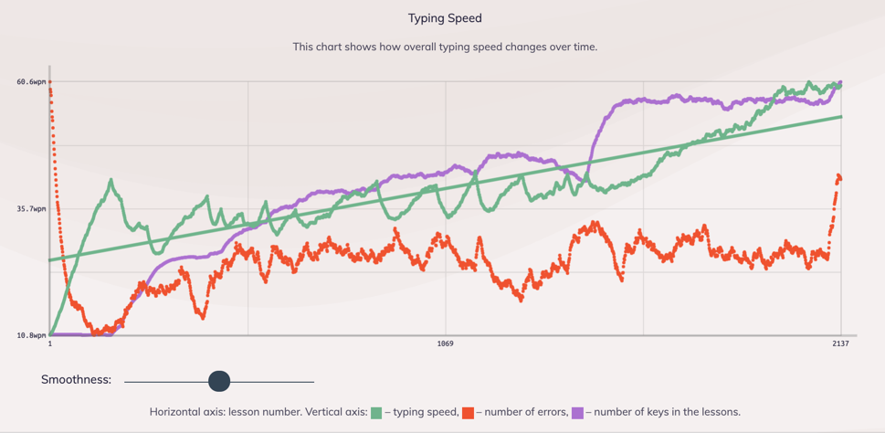

For the past few of months I have been using an alternate keyboard layout as my daily driver. The journey to this stage have not been easy but after
around 20 hours of deliberate practice over the space of 3 months. I think I have unlearned Qwerty and became somewhat proficient in Workman. This
post will talk through my experience with the Workman layout.

### What is Workman?

[Workman](https://workmanlayout.org/) is an alternative keyboard layout designed by OJ Bucao that focuses on comfort and ergonomics by maximising the
usage of keys on the home row and at the same time aimed at reducing lateral movement of fingers and wrists. It comes with some other benefits like
low finger travel, balanced left/right hand usage and maximise same hand utilisation.

My first real exposure to alternate keyboard format was around 5 years ago where I tried Dvorak, but at the time I really never got the appeal of
alternate keyboard layouts and very quickly gave up after 30 minutes. I came across Workman around about a year ago, at the time I didn't give it too
much attention given how my previous experience with alternate layouts have been. Earlier this year Workman layout showed up again on
[Hacker News](https://news.ycombinator.com/item?id=23400058) and reading thorough some comments I noticed a lot of people recommended alternative
keyboard layouts to assist with fatigue and wrist pain (something which has been nagging me recently, and I didn't want to let it develop to a full on
RSI - Repetitive Strain Disorder).

### So how did you go?

So lets start off by saying I am by no mean slow on QWERTY, I average around 95 wpm (words per minute) and max out around 110 wpm
for short bursts and this is from years and years of typing, gaming and programming on it. So my confidence in attaining the same typing speed on Workman is
rather low.

After around 24 hours of deliberate practice, I managed to achieve 60 wpm with a top speed of 75 wpm. It's important to note I didn't completely
switch over initially so I went back and forth between Workman and Qwerty until I reached around 40 wpm, this is so that I don't negatively affect my
productvity overall. This probably contributed to my slow progress overall. I have read and seem other people pick up Workman in a much shorter
timeframe than I have.

### Why put your self through it?

This started off more of a fun experiment and challenge for myself to learn a keyboard layout, it has been on my todo list for some time.

### How did I go about learning it

### The mental hurdle of flearning

### But you type slower than before...

While I typed some what slower compare to before, my wrist strains have all but gone. I am able to type comfortably without major 

### And the verdict?

